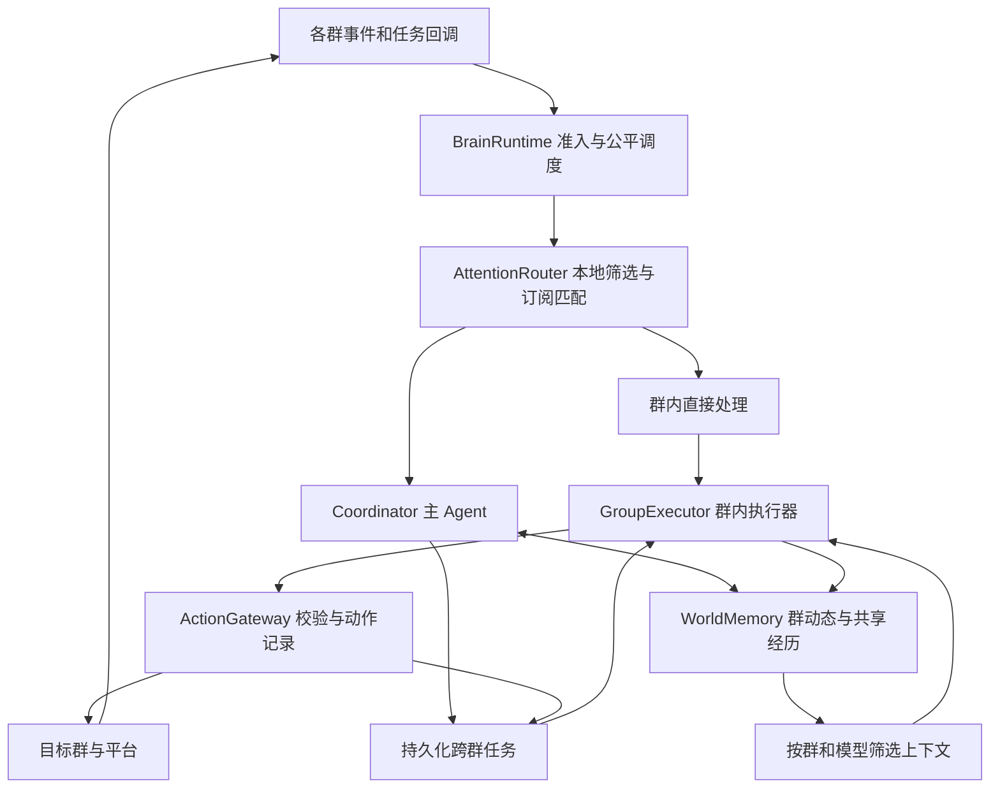
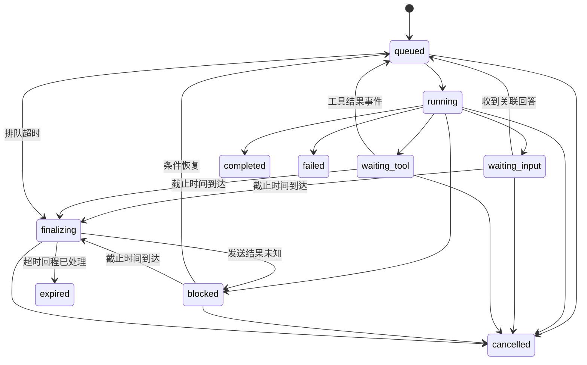

# 跨群 Agent 框架设计

状态：设计草案，尚未实现。代码基线：`8083b7d`，包含 PR #11 的并发回复修复。设计日期：2026-11-10。

采用 **主 Agent 统一管理身份、世界状态和跨群任务，群内执行器使用各群模型完成聊天** 的架构。主 Agent 的模型与维护费用由部署者统一承担；群内回复继续解析本群 API 配置和额度。这是本次设计的既定分工。

“同一个 Bot”由共享身份、带来源的经历、统一任务记录和一致的行为规则形成。主 Agent 可以同时推进多个任务；群内执行器是这个 Bot 在各群的执行回合。

## 1 用户能感受到的行为

| 场景 | 预期行为 |
| --- | --- |
| A、B 群同时有人 @ | 两个问题独立处理，分别回复各自原消息；慢任务不阻塞另一群 |
| A 群聊过公开活动，B 群问起 | 检索允许跨群使用的活动信息，知道来源和更新时间，必要时回查原文 |
| 同一人在两个群出现 | 按平台稳定用户 ID 识别同一个人；群昵称、群内关系和当前语境分别保留 |
| A 群请求去 B 群问时间 | 主 Agent 创建跨群任务，在 B 群询问；收到关联答复后回 A 群反馈 |
| B 群迟迟没有回答 | 任务进入等待，释放计算资源；到期报告未获得答复 |
| Bot 重启 | 恢复已接受的明确问题和未完成跨群任务，已确认的询问不重发 |
| 主模型不可用 | 群内模型和任务存储可用时，普通群内聊天继续；跨群协调暂停并记录原因 |
| 群模型不可用 | 该群执行步骤失败或等待恢复，其他群继续；不自动换用其他群的 API |

第一版跨群行为在配置的联动群集合内生效。私聊保留单独范围，群内风格、黑话和参与频率继续按群生效。

## 2 当前代码与改造依据

| 当前实现 | 对设计的影响 |
| --- | --- |
| [消息入口](../src/nonebot_plugin_ai_groupmate/__init__.py)把消息写入历史，再经 InputBatcher 和 GroupReplyScheduler 执行 | 接入 seam 放在消息标准化、持久化与任务准入之间 |
| [ReplyRequest](../src/nonebot_plugin_ai_groupmate/reply_request.py)含 Bot、Event、Uninfo 等活对象 | 新事件必须可序列化；执行时重新取得平台连接，不能把旧请求对象直接入库 |
| [群调度](../src/nonebot_plugin_ai_groupmate/group_reply_scheduler.py)使用内存队列，运行加排队最多 3 个明确请求，超出返回 False | 持久化准入、容量回执和排队超时需要重新定义 |
| [并发槽位](../src/nonebot_plugin_ai_groupmate/concurrency.py)已有全局和慢工具让位机制 | 复用并发控制思想，增加群间公平调度；不对整轮模型调用持全局锁 |
| [会话缓存](../src/nonebot_plugin_ai_groupmate/agent/conversation.py)按 session_id 保存，最多 1000 条消息 | 缓存用于本群对话材料；全局状态采用摘要、事件和任务，不直接合并所有群的消息列表 |
| [群档案](../src/nonebot_plugin_ai_groupmate/group_memory.py)按群保存；[用户关系](../src/nonebot_plugin_ai_groupmate/agent/context.py)按裸 user_id 查询 | 当前已有部分跨群关系信息；身份键迁移需处理平台和逻辑 Bot 归属 |
| [模型解析](../src/nonebot_plugin_ai_groupmate/group_model_config.py)已区分群 API、私聊 API 和全局 API | 群内执行沿用集中解析；新增主 Agent 专用模型角色和费用归属 |
| [公共额度](../src/nonebot_plugin_ai_groupmate/group_daily_quota.py)统计回复请求次数 | 跨群任务还需独立的模型调用预算，不能直接拿现有计数表示任务总费用 |
| [定时任务](../src/nonebot_plugin_ai_groupmate/scheduled_tasks.py)已有 SQL 抢占、租约与心跳 | 可复用模式；现有单次执行和中断语义不能直接覆盖跨群等待流程 |
| [发送恢复](../src/nonebot_plugin_ai_groupmate/delivery_recovery.py)修复已确认发送的本地记录 | 继续复用；另加发送前动作记录和发送结果未知状态 |
| [文件工作区](../src/nonebot_plugin_ai_groupmate/agent/file_workspace.py)默认文件寿命 24 小时 | 长任务需要显式持有附件，跨群访问使用受限引用 |

## 3 架构选择

比较三个接口方案：

1. **统一运行器**：入口只有 submit、inspect、cancel，准入、调度、状态与恢复都在 module 内。调用方需要知道的内容最少，故障处理集中；内部需要拆分清楚。
2. **任务工作流接口**：入口显式 start、signal、advance、commit，跨群等待和扩展能力强；普通聊天调用方会承担过多工作流概念。
3. **回复范围接口**：为现有 graph 提供 open_turn，集中装配模型、上下文和工具。对旧流程改动小，但独自使用时无法负责已接受消息的持久化与跨群等待。

选择方案一作为外部 interface；方案二的状态机作为内部任务实现；方案三作为群内 graph 的内部 seam。这样，消息入口不需要知道任务如何恢复，现有 graph 也不需要知道各群消息如何统一入队。



### 3.1 模块职责

| Module | 职责 | 对外主要 interface |
| --- | --- | --- |
| BrainRuntime | 事件准入、任务归属、优先级、公平调度、生命周期 | submit / inspect / cancel |
| AttentionRouter | 本地筛选、任务订阅匹配、候选合并和协调唤醒 | 内部 classify_event / match_watches |
| Coordinator | 跨群理解、拆解任务、选择目标、判断下一步 | 内部 advance(task_snapshot, context) → proposal |
| GroupExecutor | 用本群模型理解当前问题、调用本群工具、生成本群回复 | 内部 execute(turn_scope) → outcome |
| WorldMemory | 群动态、Bot 经历、事实来源、更正和按需检索 | 内部 build_view / record_evidence |
| ActionGateway | 校验动作范围、预留预算、记录副作用、执行及恢复 | 内部 dispatch(action) → receipt |

ORM 任务仓库和模型路由属于内部实现。第一版在现有 NoneBot 进程中运行，使用现有 ORM；达到实际容量瓶颈后再拆进程或增加独立队列。

### 3.2 主 Agent 与群内执行器怎样协作

主 Agent 产出的委派包含目标、事实材料引用、允许动作、完成条件与预算。它不替群内模型编造已经执行的结果。群内执行器返回结构化 outcome：完成内容、证据、发送回执、待协调事项。

群内执行器使用统一 Bot 人格，加上本群风格及关系资料。它可以完成一次复杂的本群任务，包括搜索、计算和绘图；需要另一个群的信息或行动时提交 `request_coordination`，交给同一任务的主 Agent 推进。

每个任务只有一个负责推进的阶段。群内执行器把任务转交主 Agent 后结束该阶段；主 Agent 再发出下一步。双方不会同时对同一个目标分别发送一份最终答案。

## 4 注意力入口与处理路径

### 4.0 哪些消息值得处理

NoneBot 接收平台消息后，先由 AttentionRouter 做本地处理。主 Agent 平时没有持续运行的模型调用；只有 CoordinatorInbox 中出现需要协调的工作，调度器才启动一个协调回合。接收消息、记录历史、生成候选、调用模型和实际回复是五个分别控制的动作。

| 输入 | 本地判定及后续动作 | 是否唤醒主模型 |
| --- | --- | --- |
| 明确 @、对 Bot 的回复 | 持久化明确请求，按消息归属进入本群执行；显式任务引用可直接协调 | 普通问题不需要；跨群需求需要 |
| 同一用户正在进行的对话补充 | 根据当前对话窗口形成候选，复用本群接话判断，确认对象后处理 | 本群执行器需要协调时才唤醒 |
| 引用某跨群任务的询问消息 | 通过 MessageRef 查 TaskWait，形成该任务的输入信号 | 任务阶段需要理解或规划时唤醒 |
| 没有引用，但可能回答某任务 | 先按目标群、等待时段、受邀成员或任务词项匹配有限订阅，进入语义候选队列 | 候选被确认与任务相关后才唤醒 |
| 绘图结果、平台回执、任务截止时间 | 直接按 action_id / task_id 定位；能由状态机处理的直接处理 | 需要新的判断时才唤醒 |
| 没有被指向、没有活动订阅命中 | 只按现有历史策略记录，不创建 Agent 待办 | 不唤醒 |
| 开启主动观察的群命中有限观察机会 | 读取一个有界窗口，按现有参与策略判断是否有值得关注的内容 | 产生跨群候选且满足预算时才唤醒 |

先处理系统回执及自己的回声，再处理真人请求和订阅命中。历史中的 @ 字样或引用文本不等于当前消息明确 @。不同真人请求不能合并成一条“最新事件”；同一订阅内的连续候选可短暂聚合，减少逐条分类。

明确请求和任务回程不参与普通闲聊的随机采样。任务截止时间由定时器索引直接唤醒到期任务，不需要循环请求模型检查所有群。

### 4.0.1 主 Agent 如何关注一件事

主 Agent 在开始跨群任务或作出持续跟进承诺时，创建有范围和有效期的 InterestWatch。普通任务可先用 TaskWait 表承载这一记录，后续再支持独立的主动关注订阅。

```text
watch_id: watch-17
task_id: trip-42
scope: B群
question_message: B群中的询问消息
participants: 组织者的稳定用户ID，或明确允许的回答者范围
subject: 本次郊游的出发时间
signals: 回复询问消息；活动名称及别名；受邀成员的可能答复
valid_until: 本次任务截止时间
purpose: 获得时间后，向A群原提问者反馈
candidate_budget: 本订阅允许的候选分类次数与Token预算
```

订阅由运行器校验并持久化，模型不能注册任意代码条件，也不能无限扩大到所有群永久监控。索引按场景和消息引用查找相关订阅；文本关键词只是筛选候选的线索，不是任务关联结论。人物相同也只是一条线索，不能把这个人在各群说的所有话都归入同一个任务。

弱关联候选使用小上下文和受限输出判断 `related / unrelated / uncertain`，包含当前消息、少量相邻消息、被等待的问题及相关身份。优先复用本轮群内模型已经得到的判断；独立触发的跨群订阅分类属于全局协调预算。候选很多时按订阅合并并限频，预算不足记录降级状态；强引用信号及明确请求仍保留。不能把每条消息换成“小模型检查”来实现全群监听。

语义判断只确认相关性及可能的答案证据。真正关闭等待、接受答案和决定如何回程，仍遵循第 8 节的等待契约和版本裁决；`uncertain` 不得直接完成任务。

### 4.0.2 需求怎样成为协调工作

本群执行器在处理明确请求时，用结构化 `request_coordination` 提交：来源问题、已经理解的目标、需要哪些群或信息、已有证据、希望返回什么结果。运行器绑定真实用户和目标能力，建立或关联 task_id；执行器随即交还该阶段，防止双方重复处理。

主 Agent 从 CoordinatorInbox 领取一个任务及其新增信号，只加载该任务的目标、已有步骤结果、尚未解决的问题和相关证据。一次协调回合的结果限定为：分配群步骤、创建等待/订阅、请求澄清、结束任务或修订事实。提交状态后退出模型调用；下一次由新事件继续。

同一任务的新信号可合并入一次协调回合，另一个人的新请求仍保留独立 task_id。简单发送回执只更新状态，固定超时通知可直接执行，无需每次唤醒主模型。

### 4.0.3 怎样联系两个群的事件

区分两种联系。**任务联系**使用 task_id、询问消息、动作回执和因果引用，是明确的执行关系。**知识联系**是在新请求到来时，用已确认的活动/项目实体、人物、时间和主题检索相关经历，是供本轮理解的背景；检索命中不能自动变成跨群任务信号。

例如 A 群提出“活动几点开始”，可以从可共享记忆检索 B 群关于同一活动的记录，核对活动身份和日期后回答。仅仅两个群都出现“八点”或“周末”不建立关联。必要时回查允许访问的原文，证据不足就澄清。

对从未参与、没有订阅、也没有被观察到的话题，Bot 不会凭空知道它与另一个群相关。这是选择性注意的能力范围。联动空间内采用活跃群自动观察，增加发现新关联的机会；观察对象和窗口受预算限制，不靠全量摘要、逐条 LLM 或新增逐条 embedding 实现。

### 4.0.4 Bot 活跃群的自动观察

跨群观察采用 `off / auto_active` 两种模式。联动空间启用后，默认使用 auto_active：由本地交互记录识别 Bot 的活跃群，自动安排有限观察。未加入联动空间、关闭观察或处于参与策略暂停状态的群不参与自动观察。

活跃度衡量真人与 Bot 的有效交流。一次有效交流由真人发起或确认承接的请求和 Bot 的实际交付组成，按 turn_id 去重；多个工具步骤、多段发送不增加次数。其他机器人发言、Bot 回声、定时广播、复读、单纯 reaction 和观察行为本身不增加活跃度。群内消息量只用于判断有没有新材料。

首轮建议参数如下，实施后依据观察命中率、费用和延迟调整：

| 条件 | 建议初值及语义 |
| --- | --- |
| 进入活跃状态 | 最近 1 小时有至少 2 次有效交流，其中至少 1 次由真人明确呼叫 Bot 发起 |
| 退出活跃状态 | 连续 2 小时没有新的有效交流；进入和退出采用不同条件，避免频繁切换 |
| 同群观察冷却 | 一次观察后 20～40 分钟，带随机偏移；这是最短等待，不保证到点一定调用 |
| 新材料门槛 | 自上次实际读取窗口之后至少有 10 条未观察的真人文本消息 |
| 单次读取 | 最近 30 分钟内最多 30 条新文本，附少量必要的引用上下文，总输入另设 token 上限 |
| 全局观察上限 | 初始最多每小时 6 次，另设每日 Token/费用预算；到期群按等待时间公平轮转 |

活跃状态和 next_due 等必要调度记录持久化，进程内缓存只作优化，重启不能把所有群同时变为到期。观察前再次校验群范围、暂停状态、新材料及预算。预算不足或没有计算槽位时延后，明确请求和任务回程优先。

观察使用全局维护模型和全局预算，输入为一个选定群的有限窗口。模型仅提取有来源的候选事件，例如活动安排、共同项目进展、已有事实的更正；允许返回空列表。默认不批量解析图片、音频和附件。普通段子、表情刷屏以及没有足够依据的话题不必形成记录。

候选事件先按来源和主题去重，再与已有共享事实、活动实体和未完成任务匹配。仅有值得保存的新事实时更新记忆；命中具体任务、影响已知跨群安排或需要协调时才进入主 Agent 收件队列。提取结果和调度器都不能把“值得观察”自动解释为“现在应该发言”。

观察与主动联动分别控制：P1 即可让活跃群的观察结果进入共享视角；是否在另一个群主动提起，仍需 P3 的目标群参与策略、分享范围和发送预算。Bot 的观察和主动发送都不能自行延长活跃状态，只有随后真人的有效交流能延长，避免自发循环。

活跃群资格与具体任务订阅相互独立。B 群暂时不活跃，也必须接收已有跨群任务的答复信号；观察额度用完不等于任务订阅失效。原有 ObservationSchedule 的低频调度思路可以复用，普通接话观察和跨群事件观察需要共享观察记录与预算仲裁，避免同一窗口被两条路径重复送模型。

### 4.1 普通群聊

1. 本地筛选确定需要处理本群问题，再持久化标准化请求；其余消息只按历史和观察策略处理。
2. BrainRuntime 创建本群 Turn；纯本群问题直接排给 GroupExecutor。
3. 按当前群和模型提供方装配本群历史、相关共享事实、人格及本轮问题。
4. 使用本群 API 执行原有 graph，通过 ActionGateway 发回当前群。
5. 记录结果；将有价值的交互作为世界状态更新候选，后台批量处理。

普通聊天无需先调用一次主模型再调用一次群模型。所有已接受请求仍属于统一运行器，主 Agent 通过被选中的事件和带范围的摘要了解相关经历；接收群消息不等于主 Agent 已经阅读它。

### 4.2 需要跨群信息或办事

入口可根据明确的任务引用、已绑定的跨群任务和已有分类结果进入协调路径。无法可靠预判时，由群内执行器升级；不只靠“另一个群”等关键词匹配。

Coordinator 读取当前任务及相关群视图，产出受限 proposal。运行器校验后创建目标群步骤，GroupExecutor 完成面向该群的表达。已有确定文本的转达可直接使用受控发送步骤，无需再做一轮无意义改写。

主 Agent 不能凭空列举并调用所有群工具。它可选择的群来自配置与当前任务的能力集合；群内执行器只获得当前步骤的目标范围。

### 4.3 主动联动

已有任务订阅命中的变化、已参与对话的确认结果，或有限主动观察发现的群动态，进入合并后的维护队列。主 Agent 按预算读取候选相关事件，例如同一活动在两个群的时间安排变化。主 Agent 生成联动提议，再通过目标群的参与频率和可分享范围检查。

第一阶段只记录联动候选。后续按群开启主动联动，每项提议记录依据、参与群、发送次数和截止时间。发送完成或被拒绝后，不因自己的回声再次触发同一联动。

## 5 身份和数据对象

### 5.1 稳定身份

| 标识 | 定义 |
| --- | --- |
| brain_id | 部署内配置的逻辑 Bot 身份，拥有人格、共享经历和任务；不同逻辑 Bot 不自动合并 |
| SceneRef | platform + scene_type + scene_id；数据库归属再带 brain_id |
| ActorRef | platform + user_id；昵称作为本群显示属性 |
| MessageRef | SceneRef + 平台消息 ID；明确该平台 ID 的有效范围 |
| transport_bot_id | 实际收发消息的账号，与逻辑 Bot 身份分开 |
| task_id / turn_id / action_id | 长任务、一次推理回合、一次外部动作的独立身份 |

同一 Bot 池的账号必须显式映射到同一个 brain_id。池内重复收到一条消息时，以逻辑 Bot、来源场景、消息 ID 和事件类型去重，实际收发账号保存在观察记录和发送回执中。明确 @ 某账号时保留该账号约束；故障切换只在该群允许的账号集合内发生。

平台没有可靠消息 ID 时使用持久化入口事件 ID，并承认跨重连去重能力有限。不能只用“文本相同”判为重复，否则用户重新提问会被吞掉。

### 5.2 外部 interface 草图

以下是设计类型，尚非可直接导入的实现。

```python
class BrainRuntime:
    async def submit(self, event: BrainEvent) -> Admission: ...
    async def inspect(self, task_id: str, actor: ActorRef) -> TaskView: ...
    async def cancel(self, task_id: str, actor: ActorRef) -> CancelResult: ...

BrainEvent = {
    "brain_id": str,
    "event_id": str,
    "kind": "message | delivery_receipt | tool_result | timer",
    "scene": SceneRef,
    "actor": ActorRef | None,
    "source_message": MessageRef | None,
    "payload_ref": str,
    "observed_at": datetime,
    "causation_id": str | None,
}

Admission = {
    "status": "accepted | duplicate | observed | rejected",
    "task_id": str | None,
    "reason": str | None,
}
```

`accepted` 表示明确请求及待处理工作已提交数据库；`observed` 表示只记录了群动态，没有承诺回复。`duplicate` 返回原始关联结果。`rejected` 区分容量、策略、关闭状态等原因，入口负责给明确请求发送简短回执。

准入先于输入合并窗口。批次的成员事件、首条到达时间和投递期限也要可恢复；现有内存 InputBatcher 只能作为唤醒优化，不能是 accepted 请求的唯一保存位置。

`inspect/cancel` 使用由平台 adapter 注入的真实操作者身份，执行任务归属校验。模型参数中声称“我是管理员”不改变操作者。

### 5.3 每轮执行契约

TurnScope 至少包括：`task_id、turn_id、origin_message、current_actor、target_scene、context_version、model_route、billing_owner、capabilities、deadline`。这些字段由运行器绑定，工具不能通过自由填写 group_id 或 user_id 更改。

TaskSpec 包括目标、来源、允许目标群、相关材料引用、完成条件、等待条件和总预算。GroupExecutor 的 outcome 包括 `completed / needs_coordination / waiting / failed`、事实证据、已确认动作和下一步需要的信息。模型隐藏推理不作为共享记忆保存。

## 6 统一视角与记忆

### 6.1 世界状态的内容

| 层次 | 保存内容 | 更新和使用方式 |
| --- | --- | --- |
| Bot 身份 | 名称、核心人格、部署者设定 | 版本化配置，每轮固定加载 |
| 群动态 | 已观察的话题、活动变化、相关成员、未完成询问 | 对选中事件增量摘要，标明实际覆盖范围与更新时间 |
| Bot 经历 | 已参与的对话、已完成事项、作出的承诺 | 来自确认的执行结果与有来源的观察 |
| 跨群事实 | 可共享活动信息、共同项目、确认的关联 | 按来源保存，更正时替代旧版本 |
| 任务状态 | 谁提出什么、在哪个群等待、还欠谁回复 | 事务更新，独立于文本摘要 |
| 原始历史 | 各群原文、图片和附件引用 | 保留原有存储，按范围检索 |

群风格和黑话只在本群应用。共同人格维持一致，本群表达方式可以不同。群动态摘要与当前 GroupMemory 的稳定群文化档案分开维护，避免临时活动挤掉长期档案。

### 6.2 更新方式和时效

原始历史接收水位、订阅扫描水位和语义观察覆盖范围分别记录。普通消息按原有策略入历史；只有已参与的交互、订阅确认的事件及活跃群观察结果进入世界记忆维护。明确承诺、任务变更和执行回执优先更新。模型没有阅读的消息不能标成“已理解”。

水位采用场景内持久化接收序号，不假设不同平台的消息 ID 可比较或消息时间严格递增。迟到、编辑和撤回各自生成事件，更正相应投影。各群视图独立更新；主 Agent 读取的只是带时间和版本的快照，不假设拥有所有群的同一瞬间状态。

摘要维护以已选择的交互和事件为输入，按需批量处理；普通群的消息数量增长本身不会触发主模型或摘要模型。联动空间内，Bot 活跃群默认获得有限跨群观察机会，按第 4.0.4 节的资格、冷却、窗口和全局预算执行；原有普通闲聊采样继续按群配置工作。

摘要记录 `observed_event_refs、covered_ranges、generated_at、source_refs、visibility_version`。选择性观察存在空洞，不能用一个最大消息 ID 声称此前所有消息均已覆盖。在负载或预算不足时允许变旧，并显示其时间；对“现在几点出发”等时效性问题回查原文，不能把旧摘要视为实时状态。

摘要可用于找线索，原文用于核实关键事实。用户更正同时更新事实状态及检索索引；旧引用保留失效标记。撤销分享或删除来源后，相关摘要、缓存和向量候选按来源关系失效，已经发出的消息另行记录。

### 6.3 上下文装配

主 Agent 每轮读取：统一人格、当前任务、来源问题、相关群摘要、待办和少量相关事实。群内执行器每轮读取：统一人格、本群风格、本群近期历史、当前用户问题、被委派的目标与允许分享的材料。

所有群的详细历史不常驻同一个上下文。首轮可将主 Agent 输入预算设为 8k token、相关群摘要最多 6 个，并为各层分配上限；实际预算还要受所选模型窗口限制。大型群集合先通过任务关联、共享实体、时间和检索挑选候选，再请求主模型。

共享经历采用追加事实和按记录版本更正。并发回合各自读取固定快照，提交增量；不会同时覆盖一篇全局“脑内总结”。当前群缓存使用 `brain_id、SceneRef、model_route_version、visibility_version`，任务上下文另按 task_id 隔离。

WorldMemory 摘要或向量检索不可用时，普通本群回复降级为本群原文与人格；依赖缺失跨群证据的步骤暂停或说明信息不可用。核心任务数据库不可用时不能宣称请求已接受，也不能另开旧路径重复执行。

## 7 跨群信息如何进入群模型

必须分别表达三个范围：**主 Agent 能读取什么、哪些信息可在目标群表达、哪些信息可发给目标模型提供方**。摘要和改写保留来源的范围，不因为换一种说法就变成公开信息。

配置以联动空间和少量能力为主：加入哪些群、共享摘要/事实/原文的层级、是否允许询问与转达、是否允许主动联动。默认私聊不加入；同平台同一用户的身份识别不自动扩大其发言的分享范围。

WorldMemory 先在代码中筛选，再生成群内 ContextView。群模型不会拿到其他群完整历史后再被提示“不要泄露”。跨群文件使用带来源、目标及有效期的 ArtifactGrant，不能通过猜文件 ID 绕过现有工作区范围。

主 Agent 可能读到多个群的资料，所以其自由生成的任务文本也可能含跨群内容。处理方式如下：

1. 协调输出优先引用受控 evidence_id 和群句柄；运行器重新解析来源和能力。
2. 任何自由生成文本都继承该次生成所读取材料的最严格可分享范围，不接受模型自行声明“可公开”。
3. 若跨群表达需要更宽的目标范围，单独用目标群及其模型允许接收的材料生成表达，再交给群执行器。无法满足时省略材料或说明缺少可分享信息。

群内执行器的提示词由运行器生成。读取的历史、群摘要及文件内容是材料，不能修改其任务身份、目标句柄或动作权限。跨群管理动作还需目标群的实际平台权限，A 群的管理员身份不自动适用于 B 群。

## 8 跨群任务状态与回程



任务状态与动作状态分别记录。`completed` 要求完成条件和必要发送回执已满足；发送结果未知时任务进入 `blocked`，不把“模型说完成了”当作完成。取消会撤销尚未执行的动作；已发出的消息属于已发生事实。

任务到期通过条件更新进入 `finalizing`，同一事务登记唯一的超时回程步骤。可用固定文案报告“尚未获得答复”，不依赖已经耗尽的主模型预算。回程有自己的短截止时间；发送确认后进入 expired，若目标已不可达则记录通知未送达后结束。未知发送留待核对，保留原始结束原因，恢复时只能继续回程，不能重新执行已过期的业务任务。到期与答案同时到达时，以任务 revision 的一次成功更新决定归属，失败一方重新读取状态。

### 8.1 A 群询问 B 群的完整过程

1. A 群 Alice 请求“去 B 群问明天几点出发”，绑定来源问题，创建 task T。
2. 主 Agent 解析 B 群句柄，检查两群联动策略、回复返回 A 群的分享范围及预算。
3. 持久化询问动作和等待意图。B 群步骤只收到必要的问题、任务目的和可分享内容。
4. B 群发送确认后记录 `question_message_id`，将等待条件绑定到 B 群、该平台消息、允许回答者规则和截止时间。
5. 任务释放推理槽位和数据库连接。回复等待由数据记录表达，进程不持有一个长期睡眠协程。
6. B 群 Bob 引用询问回答“八点”。先将消息存为事件，再关联 T；主 Agent核实回答者、原文及是否需要更多证据。
7. 主 Agent 委派 A 群回程步骤。A 群执行器结合原问题组织回答，例如“B 群的 Bob 回复说是八点”。
8. A 群发送确认，T 完成；写入有来源的任务结果及 Bot 经历。

发送确认与进入等待之间可能收到很快的回复。等待意图先入库；绑定询问消息 ID 后，重扫该群询问发出以来的已存事件，避免错过这一窗口。事件消费按唯一键去重。

TaskWait 保存完整等待契约：来源群、回程群、询问目标群、回答者范围、答案接受条件、允许返还的材料层级、策略版本、发送前事件水位和截止时间。原生引用只证明关联性；它不直接证明答复正确、回答者有权代表全群，或答案可以返回来源群。回答进入主模型前检查读取和提供方范围，回程前再检查最新分享策略。

### 8.2 回答关联

优先使用原生引用关系、明确任务标记及当前被邀请的参与者。只有时间接近或话题相似的消息进入候选集合，不能直接完成任务。多个候选不明确时保留等待，必要时让群内执行器澄清。

同一条消息可同时包含对跨群询问的回答和对 Bot 的新问题。入口可关联两个不同的处理职责，分别记录消费关系；不能为了恢复旧任务而吞掉新问题。

一次答复唤醒在同一事务内完成：验证等待仍开放、按任务和步骤 revision 条件更新、写入消费关系、关闭等待、登记下一步骤。消费唯一键包含 `(event_id, task_id, step_id, purpose)`。截止时间和取消使用相同版本条件裁决，失败方保留观察记录并重新读取状态；晚到答复不复活已过期或已取消任务。

所有系统动作携带 `root_task_id、parent_action_id、origin_brain_id`。自己的发送回声只更新动作回执和历史，不当作真人新指令。首轮跨群任务建议最多涉及 3 个群、4 次跨群发送；超过范围需在任务内明确扩展目标和预算，自动联动不能无限传递。

## 9 并发和任务所有权

沿用全局活跃推理 4、本群活跃推理 2 的默认起点。协调模型与群模型共享总上限，协调模型另设并行上限 1；维护另计预算。调度按群轮询，同一来源的大量任务不能占满全部未来槽位。

明确请求、已在等待的任务回程优先于主动闲聊和摘要。协调工作有待处理时，在下一次槽位空出后保障协调机会；不通过取消正在处理的明确问题来腾位置。任务等待人类或后台绘图时释放槽位。

计算并发与排队容量分别配置。首轮可试每群 32、全局 256 条等待步骤，并为明确问题设置排队截止时间；这些是可调的启动值。容量满时返回忙碌结果，已接受的问题继续保留。回执可按用户限频，但每个被拒绝的请求必须有可查询状态。

同一用户短时间补充仅合并尚未开始的同一轮输入，保存全部消息引用；不同人的明确问题分别建 Turn。已运行任务收到纠正时生成任务修订，在工具动作边界检查版本。需要取消时只撤销对应 turn/action 的授权，延续 PR #11 的定向撤销语义。

数据库以任务 revision 条件更新保证单任务推进；领取工作获得有时限的 lease 和递增的 fencing token。模型调用和平台 I/O 在事务外完成。旧 worker 的提议和发送请求必须被 ActionGateway 拒绝；不能只用 asyncio.Lock 作为跨进程所有权保证。

第一版部署方式是单活运行，仍使用持久化唯一约束与租约以支持重启。多活部署作为后续阶段，需要进一步验证每个平台发送、账号路由和共享文件存储的行为。

## 10 发送动作与故障恢复

ActionGateway 在执行外部动作前保存稳定 action_id、目标、参数摘要、任务版本和执行账号约束。发送协议采用以下状态：

```text
prepared → sending → confirmed
                   → failed_definite
                   → delivery_unknown
prepared → cancelled
```

同一 action_id 重试只能查询或继续这项动作，不能重新生成另一个 ID 来重复发送。图内现有工具去重继续保留，持久化动作覆盖跨回合、重启和重规划的去重。

action_id 由运行器分配，绑定唯一逻辑操作键 `(task_id, logical_step_id, effect_slot, target_scene)`。重规划必须引用现有步骤及动作结果；改写询问措辞不会获得新的 effect_slot。确实需要第二次询问时显式追加步骤并重新校验发送预算。内容哈希只用于检测参数变化，不承担任务操作的身份定义。

| 故障窗口 | 处理 |
| --- | --- |
| 动作已落库，尚未进入 sending | 可在重新校验版本、权限和预算后执行 |
| 平台明确拒绝，确认未产生副作用 | 按错误类别有限重试或失败 |
| 平台确认成功，本地历史保存失败 | 保存回执并使用现有 delivery_recovery 补记录，不再次发消息 |
| 平台可能收到，但超时或进程在回执落盘前退出 | 标记 delivery_unknown；先通过平台能力或回声核对，没有可靠证据不自动重发 |
| 任务租约在模型推理期间失效 | 丢弃旧提议，由新 worker 读取记录继续 |
| 发送进行中收到取消 | 停止后续动作，继续核实当前动作的实际结果 |

平台缺少幂等发送接口时，无法承诺网络副作用恰好一次；设计保证可确认成功不重发、结果未知不盲目重发，并保留人工处理或后续回声核对的途径。

跨群任务退出和账号离线分别处理：离线可等待到截止时间；群退出联动空间立即撤销新动作能力、使相关缓存失效，并让任务进入 blocked 或结束。再次执行前检查最新策略，不沿用旧授权。

文件通过任务持有记录延长保留至任务结束加宽限期，并受存储上限约束。持有记录不扩大可访问范围；到期清理与任务恢复共用同一引用规则。

TaskArtifactHold 引用独立 ArtifactGrant；保留期限和访问授权期限分别计算。文件还在磁盘上，也不能越过已经到期或撤销的跨群授权。

## 11 模型与费用

| 工作 | 模型配置 | 费用和额度归属 |
| --- | --- | --- |
| 跨群意图理解、计划、回程判断 | 主 Agent 专用全局模型 | 部署者的协调预算 |
| 群动态摘要、共享事实维护 | 全局维护模型，可选较低成本配置 | 部署者的维护预算 |
| A 群原生聊天 | A 群 API；未配置时走现有全局模型 | A 群模型所有者，或现有 A 群公共额度 |
| A 群发起跨群任务，在 B 群执行协调询问 | B 群正常模型解析 | B 群的联动执行额度；未配置 API 时使用该群公共模型额度 |
| B 群成员自己的新问题 | B 群正常模型解析 | B 群正常费用与额度 |
| 跨群任务回到 A 群交付 | A 群执行配置 | A 群承担，按任务创建时固定的回程费用策略记账 |

“目标群模型配置”与“谁付款”必须共同可实现：使用 B 群 API Key 时费用实际由 B 群持有人承担，不能只在日志中改成主 Agent 支付。采用用户选定的分工：协调模型全局承担，目标群执行使用目标群配置。群加入联动空间时配置可承担的联动执行次数或预算，A 群发起任务不能越过 B 群这个限额。

已确定文本的纯转达只走 ActionGateway，不产生目标群 LLM 费用。若以后要求某些目标群的执行也由部署者出资，可以增加显式 `brain_funded` 路由，使用全局模型并加载目标群风格；这必须是一项实际模型路由配置，而非只改变账单标签。

每次模型调用在开始前固定 `model_role、provider_config_ref、provider_config_version、billing_owner、task_id、step_id`。运行器绑定凭据，不让模型挑选 API Key。配置失效或预算不足进入可见的阻塞/失败状态，不能恢复时悄悄改由另一群付款。

新路径只由运行器创建不可变 ModelRoute 和 BudgetLease；群内 graph 消费绑定结果，不能再次解析并切换模型或再次扣公共回复次数。一次逻辑群执行步骤计一次公共回复额度，后续模型轮次、恢复及事件重放使用同一额度记录；实际模型重试的 Token 费用仍逐次结算。配额预留失败发生在调用前，不能先调用再发现无额度。

费用统计拆开记录：协调、维护、群内执行、embedding、外部工具。总账可按 task_id 聚合，群账只计该群承担的部分。`TokenUsage` 增加角色和费用主体等维度，另以预算 reservation 处理并发预留和结算；同一调用重试的实际费用照实记账，公共回复计数不能因事件重放重复扣除。

跨群任务预算包括主模型次数/Token、群执行次数、外部动作次数、截止时间和费用上限。厂商使用量不可得或网络结果未知时保留估算及未结算状态，不能当作零费用释放预算。

## 12 最小持久化结构

以下为逻辑记录，可在实现时合并表；不要求一次建立通用工作流引擎。

| 记录 | 关键字段和约束 |
| --- | --- |
| BrainProfile / SceneBinding | 身份版本、账号映射、群范围、联动策略、观察模式、模型角色引用；每场景归属明确 |
| BrainEvent | brain_id、event_key、场景、来源引用、因果关系、内容引用、execution_owner、routing_epoch；事件键唯一 |
| AgentTask / TaskStep | 目标、来源、状态、revision、预算、lease、fencing token、截止时间；步骤唯一 |
| TaskWait / InterestWatch | 等待/关注契约、场景和消息引用、实体线索、候选预算、截止时间、扫描水位、已消费事件关系 |
| AgentAction | action_id、逻辑操作键、目标、参数摘要、状态、发送账号、平台回执；逻辑操作键与动作 ID 分别唯一 |
| SceneDigest | 场景、实际观察的事件与覆盖区间、摘要、来源引用、策略版本、更新时间 |
| SceneAttention | 场景、去重后的有效交流记录、活跃状态、未观察材料计数、next_due、实际读取范围、观察预算归属 |
| BrainEvidence | 事实/经历、主体、来源、有效期、可用范围、更正关系、版本 |
| BudgetReservation / UsageLink | 任务、调用、模型角色、费用主体、预留与实耗；调用身份唯一 |
| TaskArtifactHold | 任务、附件引用、目标授权、保留期限；与清理逻辑共享约束 |

消息历史提交与 BrainEvent 准入需要处在同一事务，或采用可恢复的入口 outbox；不能先告知已接受再异步尝试落库。全文尽量引用现有 StructuredMessage/ChatHistory，事件表不重复保存多份原文。

普通消息可以记录观察水位并合并摘要工作；明确请求和跨群任务事件不能被后台采样覆盖。历史删除与保留期限要连带处理派生证据和事件内容引用。

## 13 代码落点

建议新增 `src/nonebot_plugin_ai_groupmate/brain/`，保持外部 interface 小，把变化集中在该 module：

```text
brain/
  types.py          身份、事件、任务与回执
  runtime.py        submit / inspect / cancel 和生命周期
  scheduler.py      持久化准入、群间公平与工作领取
  attention.py      本地筛选、活动订阅匹配、协调唤醒
  coordinator.py    主 Agent 的计划和任务推进
  executor.py       TurnScope 与现有群内 graph 的适配
  context.py        WorldMemory 和可见上下文装配
  policy.py         群联动范围、能力和模型路由
  repository.py     状态、版本、租约与记录操作
  actions.py        动作登记、校验、发送与核对
```

初期保留 [agent/graph.py](../src/nonebot_plugin_ai_groupmate/agent/graph.py)的模型工具循环及预算；将发送工具接到 ActionGateway，将跨群工具接到任务 proposal。旧工具中的当前用户、当前消息和当前群参数由 TurnScope 绑定，避免既改调度又放开任意目标参数。

`handle_reply_request` 现有额度消费与 agent 初始化中的模型解析需要随新路径一起收拢：旧路径仍走原逻辑，新路径只接受运行器已绑定的路由和额度。不能直接把完整旧回复函数套在新 reservation 外再调用一次。延迟任务通过 adapter 重建目标账号、场景和消息引用；依赖原始平台 Event 的工具逐项适配，不能伪造通用 Event 后假定所有平台操作都可恢复。

[structured_message.py](../src/nonebot_plugin_ai_groupmate/structured_message.py)、[message_repository.py](../src/nonebot_plugin_ai_groupmate/message_repository.py)继续负责原文归属。增加新完整作用域键后再开放跨平台共享；旧裸 session_id 或 user_id 无法确定归属时留在旧范围，不按名称猜测迁移。

依赖策略：调度和策略为进程内逻辑；ORM、文件使用临时数据库和目录做真实测试；模型、消息平台通过生产 adapter 与可控 fake adapter 注入。暂不新增远程服务。测试主要跨 `submit/inspect/cancel` interface 验证结果，内部模块拆分不应迫使业务用例重写。

## 14 实施阶段与验收

| 阶段 | 交付内容 | 验收门槛 |
| --- | --- | --- |
| P0 统一运行器 | 身份键、事件准入、持久化明确请求、定向取消、动作记录、群模型解析 | 两群同时 @ 不漏答；接受后重启能继续；已确认发送不重发；原有群内功能回归通过 |
| P1 跨群视角 | 活跃群自动观察、群动态、共享经历、按目标筛选检索、主模型角色与费用 | B 群相关提问能引用 A 群允许共享的事实；观察符合资格和预算；能处理更正和过期；普通聊天不新增必经主模型调用 |
| P2 跨群协作 | 主 Agent 拆任务、询问、等待、关联答复、回程、预算 | A→B→A 完整流程，任何等待阶段重启仍可恢复；错误关联不自动完成；费用归属可追溯 |
| P3 主动联动 | 群动态触发候选、主动参与策略、限额、去循环 | 同一事件不重复串群；退群/关闭联动即时阻止后续动作；全局预算耗尽时保留普通群聊 |

P0/P1 先选择两个测试群试运行。观察模式先产出“会读取哪些资料、会发往哪里”的计划和费用记录；启用后每个来源事件只有一个执行路径，不能让新旧调度器同时回复。

入口事务绑定 `execution_owner / routing_epoch`，输入批次、恢复任务和回调都继承该归属。观察模式不领取执行权。切换时停止旧路径接收新增、排空或事务移交未投递批次，再为新事件切换归属；已经接受的事件沿原责任路径完成，不因开关变化再次准入。

回退以 brain 或群集合为单位：停止接受新的跨群任务，处理/取消已有任务与未知发送状态，再恢复旧路径。已接受任务不重新当作新消息投入旧调度器。数据库使用增量迁移；关闭功能不删除共享事实或动作回执。

### 14.1 必须覆盖的测试与评测

- 两群同时 @；同群两人 @；后台闲聊取消清理期间再来两次 @，保留 PR #11 的回归。
- A 群长绘图期间 B 群正常回复；热点群持续灌入时其他群仍获得执行机会。
- 请求接收后、任务领取后、发送前、发送确认后分别注入重启；核对恢复和副作用次数。
- 两个 worker 争抢同一任务；旧 worker 租约失效后不得提交计划或发出新动作。
- 发送结果未知时不自动重发；超快回复到达等待条件绑定前仍能被恢复关联。
- 任务超时与真人答案、取消同时发生时只选择一个结局；超时回程在重启后仍能完成。
- 模型重规划或改写同一个询问时复用原动作；显式第二次询问才建立新步骤。
- 同一 Bot 池多账号重复接收；不同平台相同数字 ID；同名用户；私聊和群号相同。
- 主 Agent 读到不可分享信息后，群模型的输入和输出材料仍只来自允许的范围。
- 策略撤销、模型配置更新后缓存失效；主模型故障时本群原生聊天继续。
- 相似话题不能错误完成跨群询问；一条消息包含回答和新问题时两种职责都保留。
- 费用 reservation 并发、重复回调、跨日恢复、API Key 变更和额度耗尽。
- 新旧路径切换时存在尚未投递的输入批次，仍只能执行一次；新路径不重复调用旧额度消费。
- 没有 @、订阅命中或观察机会的大量闲聊，不因跨群框架产生模型调用；原有独立后台任务另计。
- 引用被等待的询问可唤醒正确任务；无引用的候选经语义判断后仍可拒绝或保持不确定。
- 同词不同活动、同人不同话题不错误关联；未观察范围不会被摘要标为已覆盖。
- 有限观察和弱关联候选耗尽预算时，明确请求与强关联任务信号仍可正常准入。
- 真人与 Bot 的有效交流使群进入观察集合；单纯刷屏、Bot 自发消息和观察回调不能使群活跃或续期。
- 活跃状态过期、新材料不足、参与策略暂停和预算不足时不调用观察模型；重启不重置冷却。
- 活跃群很多时按等待时间轮转；普通接话与跨群观察不重复分析同一窗口。
- 观察得到新事实可仅写记忆，不能直接触发向其他群发送；不活跃群的任务答复仍可正常恢复任务。
- 长任务附件超过 24 小时仍按任务持有规则可用；取消后能释放持有。
- 来源撤回、更正、过时摘要、没有证据的跨群联想和自己的回声循环。

真实模型评测沿用 [evals](../evals/README.md)形式，使用合成群数据和截获的消息发送。分别测本群回复质量、跨群事实归属、任务成功率、错误联动、P50/P95 延迟及各模型角色费用；启动参数根据这些指标调整，不能仅凭架构推断成本一定下降。

## 15 建议落地顺序

先建立统一任务身份和发送记录，再开放共享事实检索，随后加入 A→B→A 的等待流程。主 Agent 的统一视角与群内自有模型同时保留：主 Agent 管共同经历和协作目标，群内模型在明确范围内完成当前群的交流。

主 Agent 全局承担、群内执行各群配置的分工已经确定。实施时配置首批联动群、各群联动执行预算和共享层级；接口、状态机和恢复语义可据此直接拆分开发任务。
